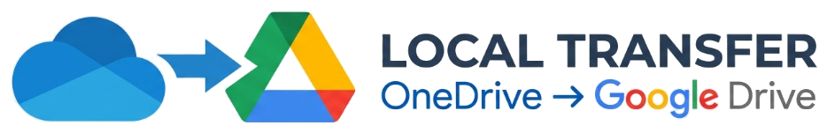

<p align="center">
  
</p>

# Local Transfer: OneDrive para Google Drive

Idioma / Language: [English](README.md) | **Portugues**

---

Ferramenta local para comparar pastas do OneDrive e do Google Drive no Windows, organizar a ordem de transferencia e copiar arquivos em lotes com verificacao de integridade (SHA-256).

## Requisitos

1. Windows 10 ou Windows 11.
2. Python 3.9 ou superior instalado (usa apenas bibliotecas padrao do Python, sem pacotes externos).
3. Aplicativos do OneDrive e do Google Drive configurados no computador.

## Como Iniciar

### Opcao 1: Pelo atalho do Windows

De dois cliques no arquivo `Iniciar_Assistente.bat`. O navegador abrira no endereco local do painel:

`http://127.0.0.1:19845/migracao`

### Opcao 2: Pelo terminal (PowerShell ou Prompt de Comando)

Na pasta do projeto, execute:

```powershell
python sync_assistant.py
```

Para encerrar o programa, feche a janela do terminal ou pressione `Ctrl + C`.

## Como Usar

1. **Selecionar pastas:** Informe o caminho da pasta de origem (OneDrive) e da pasta de destino (Google Drive), ou clique em **Procurar** para escolher.
2. **Analisar diferencas:** Clique em **Analisar Diferencas e Gerar Ordem**. O programa le a lista de arquivos das duas pastas sem iniciar downloads no OneDrive.
3. **Escolher lotes:** Na aba **Lotes Recomendados**, veja quais pastas fazem parte de cada lote clicando em **Ver pastas deste lote**.
4. **Transferir:** Clique em **Transferir Este Lote Agora** para copiar um lote unico, ou marque varios lotes e clique em **Transferir Lotes Selecionados**.
5. **Acompanhar auditoria:** Cada arquivo copiado e registrado em `logs/auditoria_transferencias.csv`.

## Estrutura de Arquivos

- `Iniciar_Assistente.bat`: Atalho para iniciar o servidor local no Windows.
- `sync_assistant.py`: Servidor web local, leitor de pastas e copiador de arquivos.
- `static/index.html`: Estrutura da pagina web (padrao de acessibilidade WCAG 2.1 AA).
- `static/styles.css`: Estilos visuais da pagina (Material Design 3).
- `static/app.js`: Controles de tela, selecao de lotes e comunicacao com o servidor.
- `ultimo_relatorio_cache.json`: Cache local do relatorio (ignorado pelo Git) para nao precisar reler todas as pastas ao reabrir o programa.
- `logs/auditoria_transferencias.csv`: Registro local (ignorado pelo Git) de todos os arquivos transferidos e verificados.

## Documentacao Detalhada

Para entender os conceitos tecnicos usados pelo programa em linguagem simples, consulte os guias abaixo:

- [Funcionamento da analise, ordem de lotes e liberacao de espaco](docs/funcionamento-e-ordem.md)
- [Seguranca da copia, codigo SHA-256 e auditoria](docs/seguranca-e-verificacao.md)

## Aviso

Este codigo foi desenvolvido com o auxilio de Inteligencia Artificial (IA). O software e fornecido no estado em que se encontra ("as is"), sem garantias de qualquer tipo. Use por sua propria conta e risco. Sempre confira seus backups antes de apagar quaisquer arquivos originais.

